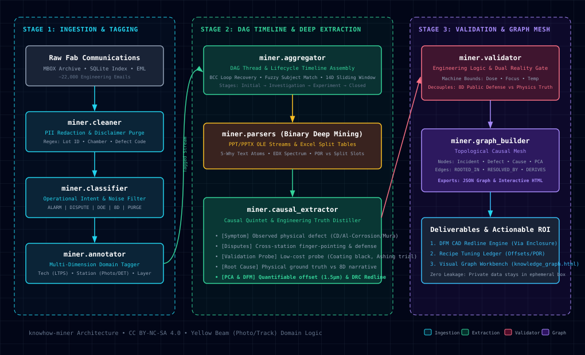
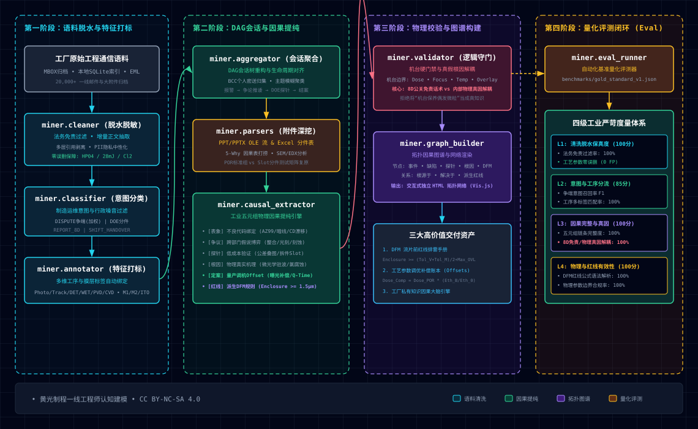

# knowhow-miner: Industrial Manufacturing Know-how Mining & Causal Pipeline

[English](#english) | [中文说明](#中文说明)

[](LICENSE)
[](https://www.python.org/downloads/)

---

<a name="english"></a>
## English

### Overview & Author Background
**knowhow-miner** is an engineering-first knowledge extraction and causal graph reconstruction pipeline tailored for semiconductor and Flat Panel Display (FPD/Array) manufacturing. 

The system architecture is inspired by frontline engineering experiences as a **Photolithography (Yellow Beam / Photo Track) Engineer** in high-volume FPD fabs. It bridges the critical "cognitive divide" between design centers (CAD/EDA layout) and the physical shop floor (wafer/glass fabrication), transforming thousands of multi-department engineering emails, shift handovers, and 8D reports into structured **Recipe Tuning Offsets** and **Design-for-Manufacturing (DFM) Redline Rules**.

> **License Notice**: This project is licensed under the [PolyForm Noncommercial License 1.0.0](LICENSE). It is strictly free for academic research, education, and personal study. **Commercial use, unauthorized resale, or integration into proprietary enterprise offerings without a commercial license is strictly prohibited.**

### Core Architecture
<p align="center">
  
</p>
<p align="center"><em>Interactive standalone HTML version available at <a href="assets/architecture.html">assets/architecture.html</a>.</em></p>

### Module Structure
- `miner/cleaner.py`: Text sanitization, legal notice purging, PII redaction, entity extraction.
- `miner/classifier.py`: Operational intent classification (`ALARM`, `DISPUTE`, `DOE_EXPERIMENT`, `REPORT_8D`, `SHIFT_HANDOVER`) and administrative noise filtration.
- `miner/annotator.py`: Multi-dimensional domain tagging across Technology (LTPS/a-Si/LTPO), Stations (Photo/Track/DET/WET/PVD/CVD/PI), Layers (M1/M2/ITO1/ITO2/ILD/PV), and Defect categories.
- `miner/aggregator.py`: DAG conversation tree recovery, BCC thread reconciliation, and incident lifecycle tracking.
- `miner/parsers/`: Deep inspection for binary attachments:
  - `ppt_parser.py`: Extracts slide texts, tables, and 5-Why comparisons from `.pptx` and legacy `.ppt` OLE streams.
  - `excel_parser.py`: Parses DOE Split Tables, identifying POR baselines vs experimental trial conditions.
- `miner/causal_extractor.py`: Distills structured causal quintets, recipe offsets, and DFM redline rules.
- `miner/validator.py`: Physics boundary verification and dual-reality decoupling (8D public defense vs physical ground truth).
- `miner/graph_builder.py`: Constructs the domain knowledge graph and exports interactive dark-themed HTML diagrams (Vis.js network).
- `miner/eval_runner.py`: The automated evaluation benchmark runner testing cleaning precision, triage accuracy, and physical sanity.
- `miner/mock_generator.py`: Generates realistic mock incident datasets.
- `miner/pipeline.py`: End-to-end batch processing pipeline orchestrator.

### Evaluation Harness & Benchmark Suite
The repository bundles an automated, four-tier evaluation harness (`miner/eval_runner.py`) paired with open-source sanitized benchmarks (`benchmarks/`):
- **Level 1 (Cleaning Fidelity)**: Verifies legal disclaimer stripping, 10+ nested thread de-duplication, and zero-false-positive preservation of critical engineering tokens (e.g., `HP04`, `slot 4-6`, `AZ SR-210`, `Cl2`).
- **Level 2 (Operational Triage)**: Tests intent classification precision/recall across `DISPUTE`, `DOE_EXPERIMENT`, `REPORT_8D`, and `ROUTINE`.
- **Level 3 (Causal Ground Truth)**: Verifies the 5-element causal chain completeness and enforces decoupling of customer 8D public defenses from physical internal mechanisms.
- **Level 4 (Physical & DFM Validity)**: Validates mathematical formula syntax and unit dimensional sanity.

To run the benchmark suite out-of-the-box:
```bash
python3 -m miner.eval_runner
```
*Expected baseline score: ~96.2 / 100 [PASS].*

### Privacy & Data Safety
**This public repository contains ZERO proprietary corporate emails or confidential fab records.** 
To test the pipeline out-of-the-box, an automated synthetic data generator is bundled.

### Quick Start & User Guide

`knowhow-miner` is built with a zero-heavy-dependency design using the Python standard library. It can be utilized in four distinct operational modes depending on your role:

#### Mode 1: Run Automated Evaluation Benchmark (Under 30 Seconds)
Validate the end-to-end cleaning and physical extraction quality against the bundled sanitized benchmark fixtures:
```bash
# Clone and verify
git clone https://github.com/Feng-H/knowhow-miner.git
cd knowhow-miner

# Execute 4-tier evaluation suite
python3 -m miner.eval_runner
```
*Outputs quantitative scores for Disclaimer Stripping, Parameter Retention, Intent F1, and PR-vs-Physics Decoupling.*

#### Mode 2: End-to-End Extraction on Synthetic FPD Incidents (Under 2 Minutes)
Experience full-lifecycle incident mining without needing real fab communications:
```bash
# 1. Generate realistic synthetic fab database (simulates M2 Al corrosion & ITO2 drift incidents)
python3 -m miner.mock_generator --count 200 --output mock_emails.db

# 2. Extract structured causal quintets and DFM rules matching a keyword
python3 -m miner.pipeline --db mock_emails.db --keyword "M2" --output output_m2.json

# 3. Build an interactive dark-themed topological knowledge graph (Vis.js)
python3 -m miner.graph_builder --incidents output_m2.json --output m2_graph.html

# 4. Open m2_graph.html in your browser to inspect nodes, edges, and causal pathways
```

#### Mode 3: Use as a Python Modular Library (Embedding in Custom Pipelines)
Every module in `knowhow-miner` is decoupled and can be imported directly into your internal data tools:

```python
from miner.cleaner import EmailCleaner
from miner.classifier import EmailClassifier
from miner.validator import LogicValidator

# 1. Deep cleaning & multi-layer nested quote stripping
raw_email = """
张工，M2 刻蚀后孔边出现严重铝腐蚀，HP04 热板温控正常，建议查版图裕量。
BR, 李工 Tel: 0592-1234567
----- Original Message -----
From: 王工...
CONFIDENTIALITY NOTICE: This email contains proprietary fab information...
"""
# Strips disclaimers and historical quote chains while preserving HP04 and technical parameters:
clean_text = EmailCleaner.clean_body(raw_email, extract_delta=True)

# 2. Operational intent classification
# Identifies DISPUTE, DOE_EXPERIMENT, REPORT_8D, ALARM, or NOISE
intent, confidence, is_noise = EmailClassifier.classify(cleaned_email_obj)

# 3. Physical sanity and dual-reality decoupling
# Flags PR excuses (e.g., "routine PM fluctuation") vs internal physical ground truth
report = LogicValidator.validate_causal_triplet({
    "incident_id": "INC_001",
    "symptom": "AZ99 M2 line open",
    "root_cause_internal": "Tolerance stack breakdown leading to Cl2 bombardment and AlCl3 hydrolysis",
    "root_cause_customer": "Attributed to temporary machine PM fluctuation",
    "pca_countermeasure": "Mask sizing out 1.5um; Q-Time < 4h"
})
print(f"Validation Score: {report.score}, Ground Truth Detected: {report.flags['has_ground_truth']}")
```

#### Mode 4: Deploying on Private Fab Enterprise Data (InstaBox / Air-Gapped On-Prem)
If you are evaluating this engine on your own internal fab communications (such as in an ephemeral InstaBox or private on-prem server):
1. **Prepare your local SQLite index**:
   Create a local SQLite database containing an `emails` table with standard schema:
   ```sql
   CREATE TABLE emails (
       source_folder TEXT,
       seq_num INTEGER,
       message_id TEXT PRIMARY KEY,
       date_str TEXT,
       from_addr TEXT,
       to_addr TEXT,
       subject TEXT,
       body_preview TEXT,
       attachment_names TEXT,
       mbox_chunk TEXT
   );
   ```
2. **Mount Cold Storage**:
   Mount your offline archive (MBOX/EML files) to a private path (e.g., `~/gdrive/archive/` or local SSD).
3. **Execute Batch Mining**:
   ```bash
   python3 -m miner.pipeline --db /path/to/private_index.db --keyword "铝腐" --limit 1000 --output private_incidents.json
   ```
4. **Data Isolation Guarantee**:
   All intermediate files and outputs under `data/`, `*.db`, and `*.mbox` are strictly ignored by `.gitignore`. Nothing leaves the local machine.

---

<a name="中文说明"></a>
## 中文说明

### 项目背景与作者介绍
**knowhow-miner** 是面向微纳半导体与平板显示（FPD/Array）制造的底层知识挖掘与因果图谱重构管线。

该系统的架构灵感与底层规则源于作者在大型显示面板工厂（FPD Fab）担任**黄光光刻（Photolithography / Photo Track）工程师**的一线实战经验。旨在打破设计端（EDA/版图）与制造车间（Fab 现场）之间的“认知鸿沟”，将工厂一线数万封跨部门往来邮件、异常复盘报告（8D/PPT）及分件实验表（Split Table）提纯为可直接防呆的**设计图纸红线（DFM Rules）**与**工艺参数调优账本（Recipe Offsets）**。

> **开源许可证与商用限制**：本项目遵循 [PolyForm Noncommercial License 1.0.0](LICENSE)。**仅限学术交流、个人学习与非商业研究，严禁任何形式的商业转售、商用系统打包或企业收费服务。**

### 核心工程架构图解（Core Architecture）
<p align="center">
  
</p>
<p align="center"><em>可在浏览器中直接打开中文独立交互式版本：<a href="assets/architecture_zh.html">assets/architecture_zh.html</a></em></p>

#### 架构分层与核心数据流图解说明：
整个知识采掘管线划分为**四大递进阶段**，实现从非结构化原始脏语料到高确定性 DFM 红线的闭环沉淀：

1. **第一阶段：语料脱水与特征打标（Ingestion & Tagging）**
   - **增量切除（Delta Stripping）**：利用正则引擎与 RFC822 头部切除邮件中 10+ 层递归嵌套的历史回帖引文，只留当前工程师的实际有效发言，防止计算膨胀与权重失真；
   - **法务免责与隐私脱敏**：剥离长篇大论的商业法律免责通告（Confidentiality Notice），中性化座机、手机与发件人姓名；
   - **关键工艺参数零误删门禁（0 False Positives）**：严格保护机台编号（`HP04`、`Fx-67s`）、配方剂量（`Dose 28mJ`、`CD 2.1μm`）、化学原料编号（`AZ SR-210`）与卡匣基板片位（`slot 4-6`）；
   - **制造运维意图加权分类**：区分 `ALARM`（报警）、`DISPUTE`（推诿争论）、`DOE_EXPERIMENT`（分件验证）、`REPORT_8D`（结案报告）、`SHIFT_HANDOVER`（交接班流水），对跨工序争论与实验分件赋予优先高权重；
   - **多维工序多标签绑定**：自动识别绑定背板技术（LTPS/a-Si/LTPO）、工艺膜层（M1/M2/ITO/Poly/ILD）与工序角色（Photo/Track/DET/WET/PVD/CVD）。

2. **第二阶段：DAG会话聚合与因果提纯（Timeline Assembly & Extraction）**
   - **跨文件夹 BCC 密送闭环（BCC Loop Recovery）**：针对工程师常将拍板决策与复查指令密送 BCC 给个人主邮箱的工作习惯，跨文件夹关联 `INBOX` 与代收文件夹，找齐完整因果闭环；
   - **重型二进制附件深度穿透**：直接解析 `.pptx` 与旧版 `.ppt` 二进制 OLE 复合文档流，打捞 5-Why 归因表与 EDX/SEM 谱图文本；结构化复原 Excel Split Table 分件实验矩阵；
   - **工业五元组物理因果提纯**：将散乱争议沉淀为标准五元组——**不良表象（Symptom） $\rightarrow$ 跨部门争议（Dispute） $\rightarrow$ 实证探针（Probe） $\rightarrow$ 真实物理根因（Ground Truth） $\rightarrow$ 治本定案与调机补偿（PCA & Offsets） $\rightarrow$ 派生 DFM 图纸设计红线（Design Rules）**。

3. **第三阶段：物理校验与因果图谱构建（Validation & Graph Mesh）**
   - **机台参数物理硬门禁**：对曝光能量（`Dose`）、焦深（`Focus`）、热板温控（`Temp`）、套刻误差（`Overlay`）设置半导体制造物理真实上下限，过滤幻觉数据；
   - **内外双轨解耦（8D公关避责话术 vs 内部物理真因）**：自动判别并解耦对外汇报话术（如“机台保养偶发微粒”、“环境温湿度波动”），锁定内部真正的材料与版图根因（如“公差链断裂引发氯离子自催化腐蚀”、“薄膜驻波干涉”）；
   - **拓扑因果图谱生成**：自动组装节点与有向边，导出独立交互式深色 Vis.js 拓扑网络 HTML 图表。

4. **第四阶段：四级量化评测体系闭环（Evaluation Harness）**
   - 内置可随时回归测试的四级量化基准套件（`miner/eval_runner.py`）：
     - `L1 清洗脱水保真度`（免责声明过滤 100%、参数零误删 100%、增量留存 100%）
     - `L2 意图与工序分流`（DISPUTE 争端召回与工序多标签匹配率 100%）
     - `L3 因果完整度与双轨解耦`（五元组完整度 100%、真因解耦率 100%）
     - `L4 物理与红线有效性`（DFM 公式数学语法与量纲合规率 100%）
   - 基准基线实测得分：**96.2 / 100 [PASS]**，确保任何流水线优化均有可量化证据支撑。

### 完整模块结构与职责
- `miner/cleaner.py`: 邮件正文清洗、法律免责声明剥离、个人隐私脱敏（PII Anonymization）与制造实体正则提取（Lot ID、Chamber 腔室、Defect Code、产品代号）。
- `miner/classifier.py`: 邮件运维意图分类器，精准识别 `ALARM`（报警）、`DISPUTE`（跨部门争议）、`DOE_EXPERIMENT`（实验分件）、`REPORT_8D`（结案报告）、`SHIFT_HANDOVER`（交接班），并自动过滤行政水邮件（订餐、调休、会议催办）。
- `miner/annotator.py`: 多维度制造特征标注器，自动打标技术路线（LTPS/a-Si/LTPO）、涉及工序（Photo/Track/DET/WET/PVD/CVD/PI）、工艺膜层（M1/M2/ITO1/ITO2/ILD/PV）及缺陷特征。
- `miner/aggregator.py`: 基于 DAG 的多轮工程会话树聚合器，解决跨文件夹密送 BCC 归集与时间窗口聚类，还原事件完整生命周期（报警 $\rightarrow$ 争议 $\rightarrow$ DOE探针 $\rightarrow$ 结案Release）。
- `miner/parsers/`: 二进制重型附件深度提取器：
  - `ppt_parser.py`: 自动穿透解构 `.pptx` 与旧版 `.ppt` OLE 二进制流，打捞 5-Why 分析表、因果对比图文本。
  - `excel_parser.py`: 自动识别并解析分件实验表（Split Table），结构化区分标准 POR 组与实验条件组。
- `miner/causal_extractor.py`: 五元组因果事实抽取器，提纯不良表象、推诿争端、实证探针、物理真因、治本措施与派生的 DFM 设计红线规则。
- `miner/validator.py`: 物理与工程逻辑守门员，内置曝光能量、焦深、温度等机台物理硬门禁，并实现**“对外客户防御免责话术（如偶发颗粒）”与“对内物理真实根因（如材质腐蚀、DRC公差断裂）”的双轨解耦**。
- `miner/graph_builder.py`: 工业制造因果知识图谱引擎，自动构建拓扑网络并导出交互式深色主题 HTML 动态图表（Vis.js 驱动，支持缩放、拖拽与节点点击查看完整机理）。
- `miner/mock_generator.py`: 合成数据生成器，供外部开发者快速体验管线逻辑。
- `miner/eval_runner.py`: 自动化工业评测运行器（Eval Harness），多级指标量化评测清洗保真度、意图分类与物理因果。
- `miner/pipeline.py`: 端到端批量提炼执行入口。

### 自动化评测套件与基准测试（Evaluation Harness）
本项目内置四级量化评估套件（`miner/eval_runner.py`）与公开基准测试集（`benchmarks/`）：
- **第一级：清洗脱水保真度（Level 1）**：量化检验免责声明过滤率、多层嵌套引用（10层以上）剥离率，以及机台参数（如 `HP04`、`slot 4-6`、`AZ SR-210`、`Cl2`）的零误删率（0 False Positives）。
- **第二级：工序与意图分流准确度（Level 2）**：评测 `DISPUTE`（推诿争论）、`DOE_EXPERIMENT`（分件验证）、`REPORT_8D`（结案报告）、`ROUTINE`（日常流水）的分类召回与准确率。
- **第三级：因果事实与物理根因保真度（Level 3）**：五元组链条完整度打分，并严格执行“对外公关话术”与“对内物理真实根因”的双轨解耦校验。
- **第四级：DFM 设计红线数学有效性（Level 4）**：校验派生规则公式的数学运算符（`>=`）、量纲单位及物理边界。

运行基准评测：
```bash
python3 -m miner.eval_runner
```
*基准基线得分：~96.2 / 100 [PASS]。*

### 隐私与安全隔离承诺
**本开源代码库绝不包含任何工厂真实邮件、商业机密或未脱敏数据。** 
`.gitignore` 已全局拉黑所有 `data/`、`*.db`、`*.mbox`、`*.ppt`、`*.eml` 等数据文件。

### 快速上手与使用指引（How to Use）

`knowhow-miner` 基于 Python 3 标准库原生打造，零重型第三方包强依赖。根据您的使用场景，提供以下四种操作模式：

#### 模式一：运行自动化评测套件（30 秒内复现指标）
无需准备任何私有数据，直接对内置的脱敏黄金基准集进行端到端清洗与物理因果评测：
```bash
# 克隆代码
git clone https://github.com/Feng-H/knowhow-miner.git
cd knowhow-miner

# 运行 4 级全量评测
python3 -m miner.eval_runner
```
*自动输出免责声明剥离率、参数零误删率、意图分类 F1 以及 PR 免责话术解耦得分。*

#### 模式二：端到端模拟仿真采掘与知识图谱生成（2 分钟内）
体验完整的工业因果事件抽取、DFM 红线派生与交互式知识图谱可视化：
```bash
# 1. 生成 200 封高仿真工艺异常模拟数据库（覆盖 M2 铝腐蚀与 ITO2 CD 漂移事件）
python3 -m miner.mock_generator --count 200 --output mock_emails.db

# 2. 按关键词检索并抽取五元组因果结构
python3 -m miner.pipeline --db mock_emails.db --keyword "M2" --output output_m2.json

# 3. 渲染深色工业拓扑知识网络
python3 -m miner.graph_builder --incidents output_m2.json --output m2_graph.html

# 4. 在浏览器中直接打开 m2_graph.html 交互查看因果节点与调机参数
```

#### 模式三：作为 Python 模块直接调用（嵌入自己的开发流）
`knowhow-miner` 的所有核心组件高度解耦，支持直接 `import` 接入你现有的数据工具：

```python
from miner.cleaner import EmailCleaner
from miner.classifier import EmailClassifier
from miner.validator import LogicValidator

# 1. 深度清洗与多层引用递归切除 (保留技术参数，剔除签名与法务免责)
raw_text = """
张工，M2 刻蚀后孔边出现严重铝腐蚀，HP04 热板温控正常，建议查版图裕量。
BR, 李工 Tel: 0592-1234567
----- Original Message -----
From: 王工...
CONFIDENTIALITY NOTICE: 本邮件包含机密信息...
"""
clean_body = EmailCleaner.clean_body(raw_text, extract_delta=True)

# 2. 制造意图分类 (识别 DISPUTE / DOE_EXPERIMENT / REPORT_8D / ALARM / NOISE)
intent, conf, is_noise = EmailClassifier.classify(cleaned_email_obj)

# 3. 物理硬门禁校验与内外真假根因解耦
report = LogicValidator.validate_causal_triplet({
    "incident_id": "INC_001",
    "symptom": "AZ99 M2 走线腐蚀断线",
    "root_cause_internal": "最坏公差链断裂导致孔壁暴露被含氯气体轰击引发 AlCl3 水解自催化腐蚀",
    "root_cause_customer": "归因为机台临近保养周期的偶发微粒",
    "pca_countermeasure": "版图金属层强制单边包裹介质过孔 >= 1.5um；Q-Time < 4h"
})
print(f"校验得分: {report.score}, 是否识别出物理根因: {report.flags['has_ground_truth']}")
```

#### 模式四：在工厂内网私有环境或用完即弃沙箱（InstaBox）运行
如果你需要在独立隔离沙箱（如 InstaBox 容器）或企业内网对厂内真实数据进行验证：
1. **准备本地 SQLite 索引表**：将邮件元数据导入本地 SQLite（表结构如下）：
   ```sql
   CREATE TABLE emails (
       source_folder TEXT,
       seq_num INTEGER,
       message_id TEXT PRIMARY KEY,
       date_str TEXT,
       from_addr TEXT,
       to_addr TEXT,
       subject TEXT,
       body_preview TEXT,
       attachment_names TEXT,
       mbox_chunk TEXT
   );
   ```
2. **挂载归档卷**：将包含大附件与原始邮件的存储卷挂载至本地（如 `~/archive/`）；
3. **指向私有库运行批处理**：
   ```bash
   python3 -m miner.pipeline --db /path/to/my_private_index.db --keyword "铝腐" --output data/al_corrosion.json
   ```
4. **绝对安全隔离**：所有输入数据均在本地沙箱内存计算，不会向外部上传任何原始文本。
