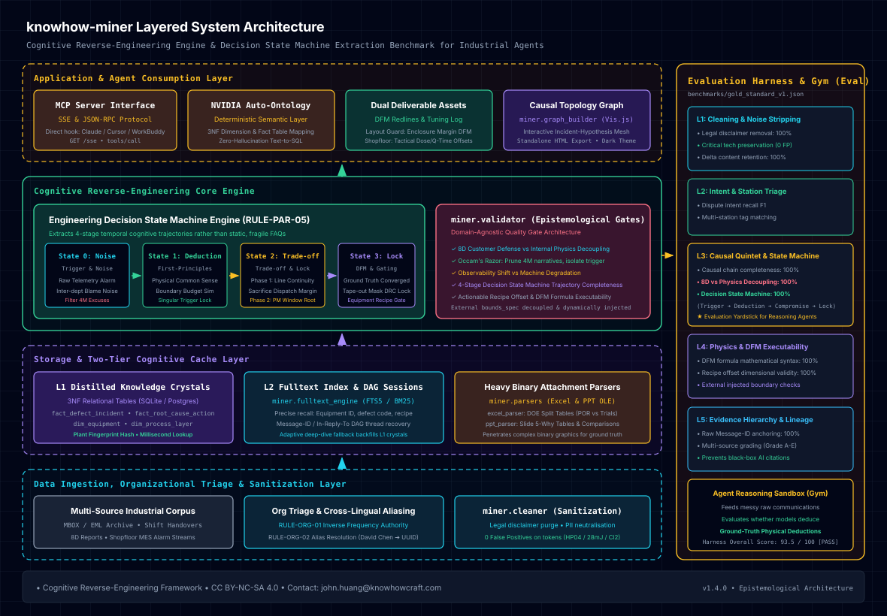

# knowhow-miner: Industrial Manufacturing Know-how Mining & Causal Pipeline

[English](README.md) | [中文说明](README_zh.md)

[](https://creativecommons.org/licenses/by-nc-sa/4.0/)
[](https://www.python.org/downloads/)
[](CHANGELOG.md)
[](docs/ENGINEERING_RULES.md)
[](AGENTS.md)

---

### Overview & Author Background
**knowhow-miner** is an engineering-first knowledge extraction and causal graph reconstruction pipeline tailored for semiconductor and Flat Panel Display (FPD/Array) manufacturing. 

The system architecture is inspired by frontline engineering experiences as a **Photolithography (Yellow Beam / Photo Track) Engineer** in high-volume FPD fabs. It bridges the critical "cognitive divide" between design centers (CAD/EDA layout) and the physical shop floor (wafer/glass fabrication), transforming thousands of multi-department engineering emails, shift handovers, and 8D reports into structured **Recipe Tuning Offsets** and **Design-for-Manufacturing (DFM) Redline Rules**.

> **License Notice**: This project is licensed under the **[Creative Commons Attribution-NonCommercial-ShareAlike 4.0 International License (CC BY-NC-SA 4.0)](LICENSE)**. It is strictly free for academic research, education, and personal study. **Commercial use, unauthorized resale, proprietary integration, or commercial derivative redistribution without an explicit commercial license is strictly prohibited.** Commercial licensing contact: `huangfengjob@gmail.com`.

---

### Core Architecture
<p align="center">
  
</p>
<p align="center"><em>Interactive standalone HTML version available at <a href="assets/architecture.html">assets/architecture.html</a>.</em></p>

---

### Module Structure
- `miner/cleaner.py`: Text sanitization, legal notice purging, PII redaction, entity extraction.
- `miner/classifier.py`: Operational intent classification (`ALARM`, `DISPUTE`, `DOE_EXPERIMENT`, `REPORT_8D`, `SHIFT_HANDOVER`) and administrative noise filtration.
- `miner/annotator.py`: Multi-dimensional domain tagging across Technology (LTPS/a-Si/LTPO), Stations (Photo/Track/DET/WET/PVD/CVD/PI), Layers (M1/M2/ITO1/ITO2/ILD/PV), and Defect categories, supporting **Pre-mining Human Alignment** (organizational triage mapping to anchor key mentors and domain leads, suppressing apprentice noise and prioritizing Grade A engineering directives) and **Bilingual Cadre Alias Resolution** (unifying English and Chinese aliases, e.g., `David Chen` <-> `陈大卫`, into deterministic identity nodes).
- `miner/aggregator.py`: DAG conversation tree recovery, BCC thread reconciliation, and incident lifecycle tracking.
- `miner/parsers/`: Deep inspection for binary attachments:
  - `ppt_parser.py`: Extracts slide texts, tables, and 5-Why comparisons from `.pptx` and legacy `.ppt` OLE streams.
  - `excel_parser.py`: Parses DOE Split Tables, identifying POR baselines vs experimental trial conditions.
- `miner/causal_extractor.py`: Distills structured causal quintets, recipe offsets, and DFM redline rules with **temporal causality enforcement**, **process-step topological validation**, and **original sender unwrapping** (accurately stripping envelope forwarder artifacts from auto-forwarded corporate mailboxes to prevent misattributing third-party memos as primary author directives).
- `miner/validator.py`: Physics boundary verification and dual-reality decoupling (8D public defense vs physical ground truth).
- `miner/graph_builder.py`: Constructs the domain knowledge graph and exports interactive dark-themed HTML diagrams (Vis.js network).
- `miner/eval_runner.py`: The automated evaluation benchmark runner testing cleaning precision, triage accuracy, and physical sanity.
- `miner/mock_generator.py`: Generates realistic mock incident datasets.
- `miner/pipeline.py`: End-to-end batch processing pipeline orchestrator.
- `miner/auto_ontology_bridge.py`: Bridges mined industrial causal quintets into normalized relational schemas (`dim_equipment`, `dim_process_layer`, `dim_defect_type`, `fact_defect_incident`, `fact_root_cause_action`) and semantic terms for **NVIDIA Auto-Ontology**.
- `schemas/industrial_ontology_schema.sql`: Standard relational DDL for deploying deterministic manufacturing semantic layers.

---

### Deterministic Semantic Layer & NVIDIA Auto-Ontology Integration
Unstructured vector RAG over technical manufacturing communication inevitably produces hallucinations and cannot handle precise parameter deltas (e.g. *\"What was the exact CDA flow rate change on the developer air knife?\"*). **knowhow-miner** implements a deterministic two-stage architecture:

1. **Relation Formalization**: Automatically normalizes mined causal quintets into 3NF relational schemas (`dim_equipment`, `dim_process_layer`, `dim_defect_type`, `fact_defect_incident`, `fact_root_cause_action`), explicitly recording parameter boundaries, units, and verification deltas.
2. **Semantic Layer Compilation (NVIDIA Auto-Ontology)**: Generates domain terms (`Air Knife`, `Suji Mura`, `Organic Layer`, `Root Cause & Action`) with synonym dictionaries, mapping them to relational columns. Exposes deterministic Text-to-SQL queries through MCP, backed by verifiable physical evidence.

---

### Frontline Physical Rules & Causality Codebook
The repository codifies frontline manufacturing physical heuristics and causality disambiguation rules into `miner/validator.py` and the centralized engineering codebook [`docs/ENGINEERING_RULES.md`](docs/ENGINEERING_RULES.md), categorized by domain prefixes:

- **`RULE-ORG-01` (Inverse Frequency Authority Law)**: Downweights high-frequency shift logs and anchors ground truth to senior master engineers (`[MENTOR]` / `David Chen`).
- **`RULE-ORG-02` (Cross-Lingual Entity Resolution)**: Unifies bilingual English aliases and Chinese names to resolve split discussion trees.
- **`RULE-FLU-01` (Equipment Hardware Boundary Probing)**: Solves high-viscosity thick organic film failures by pushing past conservative OEM guidelines to actual hardware interference limits.
- **`RULE-FLU-02` (Rheological Anisotropy & Layout Topological Alignment)**: Models micro-step fluid barrier pinning to enforce DFM layout rules aligning dense metal routing with coater scan directions.
- **`RULE-FLU-03` (Kinetic Aerodynamics vs Secondary Solute Etch)**: Decouples air turbulence from chemical evaporation micro-etching (e.g. trace TMAH developer concentration during post-bake).
- **`RULE-THM-01` (Geometric Heat Sink & Multi-Scale Amplification)**: Models how 1~2°C local thermal sinks cause sub-micron CD shrinkage, amplified non-linearly into macro optical defects (e.g., dark clusters in high-PPI displays).
- **`RULE-THM-02` (Phase Transition Shrinkage & Observability Shift)**: Distinguishes physical degradation from inspection gate shifts (e.g., 20-30% thermal shrinkage amplifying optical phase interference post-anneal).
- **`RULE-MEC-01` & `RULE-MEC-02` (Latent Trauma & Multi-Pass Exposure Models)**: Decouples upstream mechanical micro-cracks (e.g., wet strip roller stiction) from downstream thermal shock detonation (e.g., CVD high-temp vacuum fracture).
- **`RULE-PAR-01` (Occam's Razor & Singular Physical Trigger)**: Enforces parsimonious attribution to single physical change points over composite 4M1E management excuses.
- **`RULE-PAR-03` (Hardware State Machine Precedence & IS/IS-NOT Matrix)**: Mandates 30-day pre-incident hardware maintenance audits and island recipe checks to prevent secondary fallout.
- **`RULE-PAR-05` (Cognitive Trajectory & State-Machine Mining)**: Rejects static FAQ extraction in favor of 4-stage engineering decision state machines (Trigger & Noise → First-Principles Deduction → Tactical Compromise → DFM State Lock), creating evaluation benchmarks for industrial agents.

*For the full specification across all six domain categories (`RULE-ORG`, `RULE-FLU`, `RULE-THM`, `RULE-MEC`, `RULE-PAR`, `RULE-ONT`), see [`docs/ENGINEERING_RULES.md`](docs/ENGINEERING_RULES.md).*

---

### Two-Tier Know-how Retrieval (Cognitive Cache Architecture)
Generic vector RAG fails on manufacturing corpora (parameter-level distinctions like `0.8μm` vs `1.5μm` are invisible to embeddings, and chunking severs causal email threads). Instead, this repo implements an adaptive two-tier architecture that stays fast as the archive grows:

- `miner/fulltext_engine.py`: SQLite FTS5 inverted index (bm25 ranking) replacing slow `LIKE` scans — precise recall of equipment IDs, defect codes, and recipes.
- `miner/deep_retriever.py`: L2 deep dive — reconstructs full conversation threads (Message-ID / In-Reply-To, with subject-normalization fallback) and surfaces attachment evidence (Excel split tables, PPT 5-Why).
- `miner/knowledge_store.py`: L1 distilled crystal store — converged causal quintets + DFM rules + evidence anchors, indexed by plant fingerprint, millisecond lookups.
- `miner/distill.py`: Initial full-corpus mining phase — distills validated incidents into L1 crystals graded by evidence (Grade A = 0.95 confidence).
- `miner/hybrid_router.py`: Adaptive router — daily queries hit L1 first (zero full-text cost); only when confidence < 0.80 does it trigger an L2 dive, whose findings are consolidated back into L1 (cognitive evolution: the system gets faster and smarter over time).
- `miner/search.py`: Interactive CLI — `python3 -m miner.search --db mock_emails.db "M2 AZ99 腐蚀怎么处理？"`

```bash
# Generate mock corpus, distill crystals, then query interactively
python3 -m miner.mock_generator
python3 -m miner.distill
python3 -m miner.search --db mock_emails.db "5.99寸 M2 过孔边缘铝腐蚀 AZ99 怎么处理？"
```

---

### MCP (Model Context Protocol) Integration: WorkBuddy, Cursor & Claude

The KnowhowCraft industrial knowledge brain exposes native Model Context Protocol (MCP) endpoints via both Server-Sent Events (SSE) and direct JSON-RPC, allowing AI agents such as **WorkBuddy**, **Cursor**, and **Claude Desktop** to perform real-time root-cause diagnostic lookups directly within agent workflows.

#### 1. Remote SSE Configuration (Recommended)
Add the following to your agent's `mcp.json` (e.g., in WorkBuddy or Cursor settings):

```json
{
  "mcpServers": {
    "fpd-knowhowcraft": {
      "url": "https://fpd.knowhowcraft.com/sse"
    }
  }
}
```

#### 2. Local Stdio Bridge Mode
For agents requiring standard input/output (stdio) command execution:

```json
{
  "mcpServers": {
    "fpd-knowhowcraft": {
      "command": "python3",
      "args": ["miner/mcp_bridge.py"]
    }
  }
}
```

#### 3. Run Self-Hosted Local MCP Server
To run a completely self-hosted, offline MCP server on your local machine or internal fab network:

```bash
# Launch local MCP server (starts SSE on :8800/sse and JSON-RPC on :8800/mcp)
python3 -m miner.mcp_server --port 8800
```

#### 4. Commercial Token & Concurrency Administration
For enterprise administrators managing API tokens, concurrency limits, and anti-scraping quotas:

```bash
# Issue a commercial license token (365 days, 5 concurrent seats, 60 requests/min)
python3 -m miner.token_admin create --client "Semiconductor Client A" --tier commercial --days 365 --concurrency 5 --rate-limit 60

# List active tokens and usage metrics
python3 -m miner.token_admin list

# Revoke a token immediately
python3 -m miner.token_admin revoke <TOKEN_OR_ID>
```

#### Available MCP Tools:
- `fpd_diagnose_defect`: Query frontline defect root causes, cross-department disputes, split table probes, PCA permanent actions, and derived DFM redlines.
- `fpd_get_preset_cases`: List curated golden manufacturing defect scenarios (Al corrosion, CD jump, Taper slope, PR residue).
- `fpd_query_dfm_rules`: Query Tape-out DFM physical rules and formulas.

---

### Evaluation Harness & Benchmark Suite
The repository bundles an automated, six-tier evaluation harness (`miner/eval_runner.py`) paired with open-source sanitized benchmarks (`benchmarks/`):\n- **Level 1 (Cleaning Fidelity)**: Verifies legal disclaimer stripping, 10+ nested thread de-duplication, and zero-false-positive preservation of critical engineering tokens (e.g., `HP04`, `slot 4-6`, `AZ SR-210`, `Cl2`).
- **Level 2 (Operational Triage)**: Tests intent classification precision/recall across `DISPUTE`, `DOE_EXPERIMENT`, `REPORT_8D`, and `ROUTINE`.
- **Level 3 (Causal Ground Truth)**: Verifies the 5-element causal chain completeness and enforces decoupling of customer 8D public defenses from physical internal mechanisms.
- **Level 4 (Physical & DFM Validity)**: Validates mathematical formula syntax and unit dimensional sanity.
- **Level 5 (Evidence Hierarchy & Citation Traceability)**: Validates FDE 5-tier evidence grading (Grade A-E), multi-source conflict arbitration, and exact citation anchoring back to Message-IDs and raw quotes.
- **Level 6 (Two-Tier Retrieval, End-to-End)**: Fires real troubleshooting queries through the HybridRouter against an indexed corpus — measures routing accuracy (L1 hit vs L2 dive), L1 crystal cache precision, L2 Recall@K on must-recall Message-IDs, and the cognitive-evolution rate (L2 dives consolidating back into L1). No answers are fed in; every case executes real SQL retrieval.

To run the benchmark suite out-of-the-box:
```bash
python3 -m miner.mock_generator
python3 -m miner.eval_runner --index-db mock_emails.db
```
*Expected baseline score: ~97.8 / 100 [PASS] (Level 6 enabled).*

---

### Model & Runtime Architecture: Zero-LLM Deterministic Core
- **Zero-LLM Runtime Independence**: The entire runtime pipeline (`eval_runner`, `fulltext_engine`, `hybrid_router`, `codebook`, `validator`) runs entirely on **deterministic symbolic logic and native SQLite3 FTS5** using Python 3 standard libraries. It requires **zero external LLM APIs, zero token costs, and zero cloud calls**. This design completely prevents sensitive factory email leakage and ensures benchmark scores (97.8/100) are 100% deterministic and reproducible on any CPU within 15 milliseconds.
- **Development & Analysis**: Domain codebooks and pipeline architecture were designed and engineered with the assistance of Hermes Agent (`gemini-3.8-flash-high`) via local proxy.
- **Future Production Extension**: An offline, self-hosted LLM (e.g. DeepSeek-R1 or Qwen2.5-14B) can optionally be connected solely to the L2 deep synthesizer for automated causal quintet consolidation during low-confidence deep dives. Once saved into L1 crystals, routine lookups return to 0-LLM, sub-millisecond execution.

---

### Privacy & Data Safety
**This public repository contains ZERO proprietary corporate emails or confidential fab records.** 
To test the pipeline out-of-the-box, an automated synthetic data generator is bundled.

---

### Quick Start & User Guide

`knowhow-miner` is built with a zero-heavy-dependency design using the Python standard library. It can be utilized in four distinct operational modes depending on your role:

#### Mode 1: Run Automated Evaluation Benchmark (Under 30 Seconds)
Validate the end-to-end cleaning and physical extraction quality against the bundled sanitized benchmark fixtures:
```bash
# Clone and verify
git clone https://github.com/Feng-H/knowhow-miner.git
cd knowhow-miner

# Execute evaluation suite
python3 -m miner.eval_runner
```
*Outputs quantitative scores for Disclaimer Stripping, Parameter Retention, Intent F1, and PR-vs-Physics Decoupling.*

#### Mode 2: End-to-End Extraction on Synthetic FPD Incidents (Under 2 Minutes)
Experience full-lifecycle incident mining without needing real fab communications:
```bash
# 1. Generate realistic synthetic fab database (simulates M2 Al corrosion & ITO2 drift incidents)
python3 -m miner.mock_generator --count 200 --output mock_emails.db

# 2. Extract structured causal quintets and DFM rules matching a keyword
python3 -m miner.pipeline --db mock_emails.db --keyword "M2" --output output_m2.json

# 3. Build an interactive dark-themed topological knowledge graph (Vis.js)
python3 -m miner.graph_builder --incidents output_m2.json --output m2_graph.html

# 4. Open m2_graph.html in your browser to inspect nodes, edges, and causal pathways
```

#### Mode 3: Use as a Python Modular Library (Embedding in Custom Pipelines)
Every module in `knowhow-miner` is decoupled and can be imported directly into your internal data tools:

```python
from miner.cleaner import EmailCleaner
from miner.classifier import EmailClassifier
from miner.validator import LogicValidator

# 1. Deep cleaning & multi-layer nested quote stripping
raw_email = """
张工，M2 刻蚀后孔边出现严重铝腐蚀，HP04 热板温控正常，建议查版图裕量。
BR, 李工 Tel: 0592-1234567
----- Original Message -----
From: 王工...
CONFIDENTIALITY NOTICE: This email contains proprietary fab information...
"""
# Strips disclaimers and historical quote chains while preserving HP04 and technical parameters:
clean_text = EmailCleaner.clean_body(raw_email, extract_delta=True)

# 2. Operational intent classification
# Identifies DISPUTE, DOE_EXPERIMENT, REPORT_8D, ALARM, or NOISE
intent, confidence, is_noise = EmailClassifier.classify(cleaned_email_obj)

# 3. Physical sanity and dual-reality decoupling
# Flags PR excuses (e.g., "routine PM fluctuation") vs internal physical ground truth
report = LogicValidator.validate_causal_triplet({
    "incident_id": "INC_001",
    "symptom": "AZ99 M2 line open",
    "root_cause_internal": "Tolerance stack breakdown leading to Cl2 bombardment and AlCl3 hydrolysis",
    "root_cause_customer": "Attributed to temporary machine PM fluctuation",
    "pca_countermeasure": "Mask sizing out 1.5um; Q-Time < 4h"
})
print(f"Validation Score: {report.score}, Ground Truth Detected: {report.flags['has_ground_truth']}")
```

#### Mode 4: Deploying on Private Fab Enterprise Data (InstaBox / Air-Gapped On-Prem)
If you are evaluating this engine on your own internal fab communications (such as in an ephemeral InstaBox or private on-prem server):
1. **Prepare your local SQLite index**:
   Create a local SQLite database containing an `emails` table with standard schema:
   ```sql
   CREATE TABLE emails (
       source_folder TEXT,
       seq_num INTEGER,
       message_id TEXT PRIMARY KEY,
       date_str TEXT,
       from_addr TEXT,
       to_addr TEXT,
       subject TEXT,
       body_preview TEXT,
       attachment_names TEXT,
       mbox_chunk TEXT
   );
   ```
2. **Mount Cold Storage**:
   Mount your offline archive (MBOX/EML files) to a private path (e.g., `~/gdrive/archive/` or local SSD).
3. **Execute Batch Mining**:
   ```bash
   python3 -m miner.pipeline --db /path/to/private_index.db --keyword "铝腐" --limit 1000 --output private_incidents.json
   ```
4. **Data Isolation Guarantee**:
   All intermediate files and outputs under `data/`, `*.db`, and `*.mbox` are strictly ignored by `.gitignore`. Nothing leaves the local machine.

---

### Acknowledgments & Upstream Attribution
This project integrates with and builds upon **[NVIDIA Auto-Ontology](https://github.com/NVIDIA/auto-ontology)**, an open-source framework developed by NVIDIA for automated enterprise semantic layer construction and deterministic Text-to-SQL generation. We gratefully acknowledge NVIDIA's pioneering contribution to open-source semantic modeling and Agent data access.
