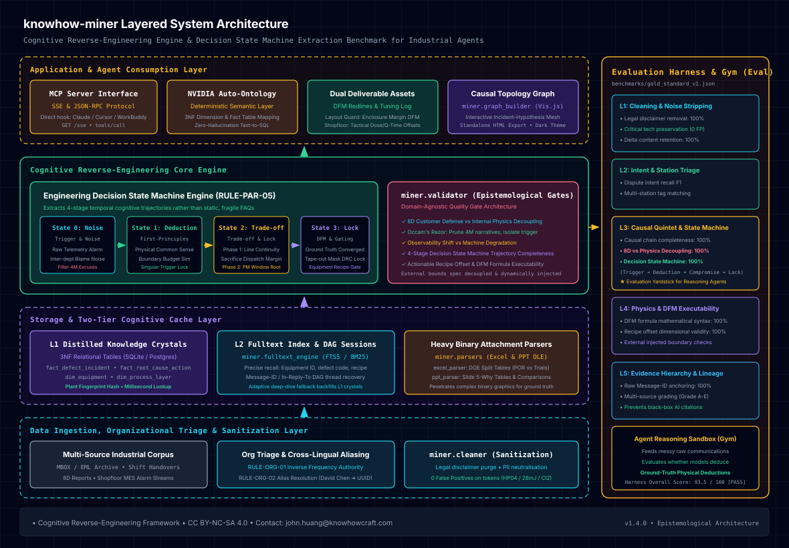

# knowhow-miner: 面向复杂工业通信的认知逆向工程与工程师决策状态机提取框架

[English](README.md) | [中文说明](README_zh.md)

[](https://creativecommons.org/licenses/by-nc-sa/4.0/)
[](https://www.python.org/downloads/)
[](CHANGELOG.md)
[](docs/ENGINEERING_RULES.md)
[](AGENTS.md)

---

### 方法论哲学与核心定位
**knowhow-miner** 是一个开源的**工业认知工程方法论母机与 Agent 评测基准框架**，旨在从充满推诿、噪音与信息断代的复杂一线生产通信（跨部门攻坚邮件、交接班日志、8D 报告）中，逆向提纯出资深工程师的真实决策心智。

系统坚决摒弃“静态概念词典 / 故障维修 SOP 问答库”的低维旧路，将工业知识采掘全面升华为**“四阶工程师决策状态机（Decision State Machine）”**通用建模：

| 范式维度 | 传统工业 RAG / 静态 FAQ | knowhow-miner（决策状态机母机） |
| :--- | :--- | :--- |
| **输入** | 离散关键词（如 `Mura`、`CD OOC`） | **现场表象与噪音（Trigger & Noise）**：首封报警假象、机台假报警与跨部门推诿假说。 |
| **认知核心** | 静态死板答案（“修改 Recipe 为 Y”） | **第一性原理剪枝（First-Principles Deduction）**：记录工程师为何基于物理常识否定表面假说、通过何种物理边界对比锁定真因。 |
| **工程现实** | 理想化一键消除 | **动态互锁与阶段妥协（Trade-off & Interlock）**：阶段一牺牲何种调度裕度做临时代偿保不停线；阶段二在何种检修窗口实施硬件改造与 DFM 锁版。 |
| **产出成果** | 供人翻阅的被动文档 | **面向工业 Reasoning Agent 的可执行评测基准（Gym Benchmark）**：检验智能体在面对海量噪音时能否推导出正确的工程裁决。 |

> **实战案例实证说明（Empirical Pilot Grounding）**：本框架的方法论模型由作者在超大规模微纳半导体与平板显示（FPD/Array）光刻量产一线攻坚实战中磨砺校准。车间具体故障（如特定过孔腐蚀、气流风刀、热板顶针等）在项目中**严格作为验证认知方法论的实战案例证据，绝不作为硬编码规则本身**，从根本上防止算法过拟合到单一孤立缺陷。

> **开源许可证与商业化防侵权声明**：本项目采用 **[知识共享署名-非商业性使用-相同方式共享 4.0 国际许可协议（CC BY-NC-SA 4.0）](LICENSE)** 开源。仅供学术研究、个人学习与教育用途免费使用。**严禁任何企业或个人在未经原作者书面授权的情况下将本项目用于商业销售、闭源分发、付费技术咨询或作为商业系统的底层私有化集成。** 商业授权咨询与技术支持请联系作者：`john.huang@knowhowcraft.com`。

---

### 核心架构图
<p align="center">
  
</p>
<p align="center"><em>可交互独立 HTML 架构演示位于 <a href="assets/architecture.html">assets/architecture.html</a>。</em></p>

---

### 核心模块概览
- `miner/cleaner.py`: 工业文本深度清洗、法务免责声明剥离、PII 敏感人名脱敏与关键工艺实体保护。
- `miner/classifier.py`: 制造意图分类器（识别 `ALARM` 报警、`DISPUTE` 推诿争议、`DOE_EXPERIMENT` 分件验证、`REPORT_8D` 结案报告、`SHIFT_HANDOVER` 值班交接），剔除订餐、排班等行政噪音。
- `miner/annotator.py`: 多维特征标注器，涵盖技术路线（LTPS/a-Si/LTPO）、工序站点（Photo/Track/DET/WET/PVD/CVD/PI）、膜层（M1/M2/ITO1/ITO2/ILD/PV）与缺陷大类，支持**前置组织阵眼对齐**（组织层级过滤，将技术事实定锚于主理师傅与带队组长，抑制学徒日常噪音）与**中英文干部别名实体消歧**（将中英文署名与拼音缩写如 `David Chen` <-> `陈大卫` 归一化为确定性人员节点）。
- `miner/aggregator.py`: 会话 DAG 树深度还原、发信箱与 BCC 密送闭环对齐、事件全生命周期时序归纳。
- `miner/parsers/`: 深度二进制工业附件解析器：
  - `ppt_parser.py`: 从新版 `.pptx` 与旧版 `.ppt` OLE 二进制流中提取 5-Why、多版本对比表与因果分析段落。
  - `excel_parser.py`: 解析研发 DOE 分件表（Split Table），精准识别量产基准组（POR）与实验条件组。
- `miner/causal_extractor.py`: 工业因果五元组提纯核心，生成调机补偿量与 DFM 设计红线，内置**严格时序因果律**（$T_{solution} > T_{incident}$）、**制造工序拓扑锚定**与**外层信封穿透**（精准解包早期企业邮箱自动转发外壳，防止误判发件人）。
- **`miner/validator.py`**：通用工程认识论质量门禁引擎。负责因果归因极简律（奥卡姆剃刀剪枝）、四阶决策状态机完整性审查、观测位移与真实物理劣化解耦，以及客户防守话术与内部物理真因的二值判别。引擎完全剥离具体工序硬编码，具备跨行业通用性。
- `miner/graph_builder.py`: 拓扑因果知识网络构建器，输出深色主题、支持缩放交互的 HTML 知识图谱（Vis.js 驱动）。
- `miner/eval_runner.py`: 自动化六级工业评测套件，量化评估清洗保真度、意图分流与因果物理有效性。
- `miner/mock_generator.py`: 合成数据生成器，供外部开发者快速体验管线逻辑。
- `miner/pipeline.py`: 端到端批量提炼执行入口。
- `miner/auto_ontology_bridge.py`: 工业本体语义桥接器，将提取的工业制造因果事实转换为标准三范式关系表（设备维表、膜层维表、缺陷维表、异常事实表、根因对策表），并自动生成 **NVIDIA Auto-Ontology** 规范的专业术语同义词词典与 Text-to-SQL 语义层实体。
- `schemas/industrial_ontology_schema.sql`: 工业确定性语义层与实体关系数据库标准 DDL。

---

### 确定性语义层与 NVIDIA Auto-Ontology 架构打通
通用向量 RAG 在制造业高精密数据上面临不可避免的“幻觉与参数失真”缺陷（大模型无法准确回答“显影风刀 CDA 流量究竟改动了多少 L/min”）。**knowhow-miner** 提供两阶段确定性治理方案：

1. **结构化范式沉淀（Relation Formalization）**：将非结构化工程讨论自动蒸馏为严格的 3NF 关系型数据（`dim_equipment`、`dim_process_layer`、`dim_defect_type`、`fact_defect_incident`、`fact_root_cause_action`），参数改动前（`param_before`）与改动后（`param_after`）具有明确量纲，杜绝向量模糊匹配。
2. **语义层治理与 Text-to-SQL 桥接（NVIDIA Auto-Ontology）**：自动提取行业术语（`显影风刀/AK`、`竖条纹/Suji Mura`、`厚胶有机膜`、`根因对策`）及其同义词映射，绑定至数据库字段。外部 Agent（Hermes、Cursor、Claude）通过 MCP 发起查询时，由 Auto-Ontology 翻译为高可靠的确定性 SQL 执行，言必有据、带血统溯源。

---

### 一线实战物理准则与因果代码本（Engineering Rules & Causality Codebook）
本仓库将产线一线实战经验提炼为通用的工业认知工程方法论，固化于 `miner/validator.py` 及统一的实战工程准则文档 [`docs/ENGINEERING_RULES.md`](docs/ENGINEERING_RULES.md)，采用领域前缀分类标识：

- **`RULE-ORG-01`（组织阵眼权威反比定律）**：发信频次与决策权威度呈反比，算法逆向抑制新人高频值班事务性噪音，将技术事实严格定锚于资深专家（`[MENTOR]` / `David Chen`）。
- **`RULE-ORG-02`（跨语种多源实体消歧准则）**：打通中英文署名与别名映射，归一化为统一 UUID，防止同人异名撕裂会话决策树。
- **`RULE-FLU-01`（设备硬件安全底线探针法则）**：突破原厂保守参数限制，逼出狭缝涂布绝对机械干涉底线（如 60μm），在安全边界上方建立极限参数带解决特种厚膜破膜。
- **`RULE-FLU-02`（流变各向异性与 DFM 走线拓扑反推法则）**：微观密集走线垂直涂布如同拦水坝诱发空化脱气，反推 CAD 设计端强制主走线与涂布方向平行。
- **`RULE-FLU-03`（动能剪切 vs 溶质二次富集解耦法则）**：解耦近距离气动湍流直吹与化学微量残液（如 TMAH）在后烘烤急剧脱水浓缩微腐蚀有机膜形成白条的二叉物理机制。
- **`RULE-THM-01`（几何热沉微温差与跨尺度非线性放大模型）**：贯通预烘热板顶针局部导热漏热 1~2°C ➔ 亚微米 CD 偏小 0.2μm ➔ 高 PPI 低灰阶电场驱动不足发暗 ➔ 陶瓷顶针与多温区局域热学补偿治理。
- **`RULE-THM-02`（相变体积收缩与检测站点位移显像模型）**：解耦机台真实物理劣化与目检关卡后移。涂布显影后（PHT）光阻含溶剂掩盖微观厚度差，目检站点后移至 230℃ 退火坚膜（ANN）后，树脂 20%~30% 体积剧烈收缩导致微观相位差被几何放大而显形。系统能准确识别此类型“假性突发异常”，防止错判前道机台劣化。
- **`RULE-MEC-01` & `RULE-MEC-02`（机械接触暗伤潜伏与时空解耦模型）**：建立多重循环累积暴露因果模型，揭示剥膜段双滚轮药液结晶卡滞在倒角植入微裂纹（暗伤）、后道 CVD 高温真空腔热应力剧烈引爆粉碎的跨工段时空解耦机理。
- **`RULE-PAR-01`（奥卡姆剃刀与单点物理突变归因极简律）**：企业 8D 汇报为应付评审往往习惯拼凑“人机料法环（4M1E）”复合假象。管线内置反编造守门员：当现场存在清晰的单一物理参数变动（如显影风刀流量由 1200 增至 1650 L/min、滚轮轴承卡滞间隙）与良率恢复直接因果闭环时，强行剪枝宏观泛化的 4M 借口，锁定极简物理触发点。
- **`RULE-PAR-03`（硬件状态机优先审查与四维控制变量归因准则）**：发生 1.0μm 级灾难突变时严禁下游盲目补偿，强制倒查前置 30 天硬件维护记录与孤岛独立配方。
- **`RULE-PAR-05`（工程师决策状态机轨迹提取准则）**：拒绝平庸的静态 FAQ/文档库，强制提取“现场噪音假象 ➔ 第一性原理剪枝 ➔ 动态互锁与战术妥协 ➔ 闭环锁版 DFM”四阶时序决策流，构建评测工业 Agent 靠不靠谱的可验证沙盒基准。

*完整六大领域（`RULE-ORG`、`RULE-FLU`、`RULE-THM`、`RULE-MEC`、`RULE-PAR`、`RULE-ONT`）因果准则规范详见 [`docs/ENGINEERING_RULES.md`](docs/ENGINEERING_RULES.md)。*

---

### 两层认知缓存与全文检索架构（Two-Tier Retrieval）
通用向量 RAG 在制造业语料上会失效（embedding 分不清 `0.8μm` 与 `1.5μm` 的毫厘之差，切块会切断邮件因果链）。本仓库实现自适应双层架构，**系统不随邮件库增长而变慢**：

- `miner/fulltext_engine.py`：SQLite FTS5 倒排全文索引（bm25 排序），毫秒级精准召回机台号、缺陷代码、配方参数，取代 `LIKE` 全表扫描。
- `miner/deep_retriever.py`：L2 深潜器——按 Message-ID / In-Reply-To 还原完整会话树（缺头字段时回退主题归一化分组），并识别附件证据（Excel 分件表 / PPT 5-Why）。
- `miner/knowledge_store.py`：L1 知识结晶库——已收敛因果五元组 + DFM 规则 + 证据锚点，按工厂指纹索引，毫秒级查询。
- `miner/distill.py`：初期全量挖掘阶段——将已验证事件按证据分级蒸馏进 L1（Grade A 置信 0.95 起步）。
- `miner/hybrid_router.py`：自适应路由器——日常查询先打 L1（零全文开销）；置信度 < 0.80 才触发 L2 深潜，深潜结果自动结晶回填 L1（认知进化：越用越快越聪明）。
- `miner/search.py`：终端交互检索入口——`python3 -m miner.search --db mock_emails.db "M2 AZ99 腐蚀怎么处理？"`

```bash
# 生成模拟语料 → 蒸馏结晶 → 交互检索
python3 -m miner.mock_generator
python3 -m miner.distill
python3 -m miner.search --db mock_emails.db "5.99寸 M2 过孔边缘铝腐蚀 AZ99 怎么处理？"
```

---

### MCP（模型上下文协议）集成：对接 WorkBuddy、Cursor、Claude 与外部 Agent

KnowhowCraft 工业知识大脑原生支持标准 Model Context Protocol（MCP），同时提供 Server-Sent Events（SSE）长连接与无状态 JSON-RPC 端点，可将半导体显示一线工艺研判大脑作为子 Agent / 工具直接挂载至 **腾讯 WorkBuddy**、**Cursor**、**Claude Desktop** 等智能体工作流中。

#### 1. 远程 SSE 方式接入（推荐）
在 WorkBuddy（`~/.workbuddy/mcp.json` 或设置界面）或 Cursor 中直接配置远程 SSE 链接：

```json
{
  "mcpServers": {
    "fpd-knowhowcraft": {
      "url": "https://fpd.knowhowcraft.com/sse"
    }
  }
}
```

#### 2. 本地命令行 Stdio 桥接模式
针对仅支持标准输入输出（stdio）命令行调用的 Agent 环境：

```json
{
  "mcpServers": {
    "fpd-knowhowcraft": {
      "command": "python3",
      "args": ["miner/mcp_bridge.py"]
    }
  }
}
```

#### 3. 运行本地开源离线 MCP 服务器
若需在本地或工厂内网独立拉起完全离线的 MCP 服务：

```bash
# 启动本地 MCP 服务（提供 :8800/sse 与 :8800/mcp 端点）
python3 -m miner.mcp_server --port 8800
```

#### 4. 商业授权 Token、并发限制与防爬风控管理
若对外部团队或客户开放服务，可使用内置的授权与风控发卡工具：

```bash
# 发行商业授权 Token（例如：365天有效期、5席位并发、60次/分钟）
python3 -m miner.token_admin create --client "某微电子客户" --tier commercial --days 365 --concurrency 5 --rate-limit 60

# 查看所有授权 Token 与调用指标
python3 -m miner.token_admin list

# 客户停缴或异常时一键吊销
python3 -m miner.token_admin revoke <Token或ID>
```

#### 暴露的 MCP 工具清单：
- `fpd_diagnose_defect`：工艺异常与缺陷因果研判（输入缺陷现象或代码，返回脱敏物理根因、推诿争议、分件验证探针、PCA 治本对策与 DFM 设计红线）。
- `fpd_get_preset_cases`：获取已收录的金标准实战案例清单（M2铝腐蚀、ITO2 CD漂移、M1坡度RC延迟、17300显影残留等）。
- `fpd_query_dfm_rules`：检索流片前 DFM 设计红线及工程物理公式。

---

### 自动化评测套件与基准测试（Evaluation Harness）
本项目内置六级量化评估套件（`miner/eval_runner.py`）与公开基准测试集（`benchmarks/`）：
- **第一级：清洗脱水保真度（Level 1）**：量化检验免责声明过滤率、多层嵌套引用（10层以上）剥离率，以及机台参数（如 `HP04`、`slot 4-6`、`AZ SR-210`、`Cl2`）的零误删率（0 False Positives）。
- **第二级：工序与意图分流准确度（Level 2）**：评测 `DISPUTE`（推诿争论）、`DOE_EXPERIMENT`（分件验证）、`REPORT_8D`（结案报告）、`ROUTINE`（日常流水）的分类召回与准确率。
- **第三级：因果事实与物理根因保真度（Level 3）**：五元组链条完整度打分，并严格执行“对外公关话术”与“对内物理真实根因”的双轨解耦校验。
- **第四级：DFM 设计红线数学有效性（Level 4）**：校验派生规则公式的数学运算符（`>=`）、量纲单位及物理边界。
- **第五级：证据分级与可溯源凭证（Level 5）**：借鉴前线部署工程师（FDE）实践，建立 A-E 五级证据天平（主管定案/分件实测/跨部门对齐/单方推诿/正则候选），解决多模态数据冲突，并将因果五元组强绑定至具体的邮件 Message-ID 及引文原句。
- **第六级：两层检索端到端评测（Level 6）**：以真实排查问题穿过 HybridRouter 对索引库执行真实 SQL 检索——评测路由准确率（L1 命中 vs L2 深潜）、L1 结晶精度、L2 Recall@K（必须召回的 Message-ID）与认知进化率（L2 深潜回填 L1 成功率）。所有用例不预先喂答案，全部真刀真枪跑检索。

运行基准评测：
```bash
python3 -m miner.mock_generator
python3 -m miner.eval_runner --index-db mock_emails.db
```
*基准基线得分：~97.8 / 100 [PASS]（含 Level 6）。*

---

### 模型与运行架构：零大模型（Zero-LLM）确定性底座
- **运行期 0 大模型依赖**：整个运行期管线（`eval_runner`、`fulltext_engine`、`hybrid_router`、`codebook`、`validator`）基于原生 Python 3 标准库、SQLite3 FTS5 倒排索引与符号物理量纲规则构建，**0 外部大模型 API 调用、0 Token 费用、0 云端请求**。这种设计杜绝了将工厂机密邮件发往云端的泄密风险，同时确保基准得分（97.8 分）100% 确定可复现，且在普通 CPU 上 15 毫秒即可闪电跑完。
- **开发与暗号逆向**：车间暗号字典（Codebook）与管线架构设计由 Hermes Agent（`gemini-3.8-flash-high`）通过本地代理协同完成。
- **未来生产环境演进（可选接入）**：在正式工厂落地中，仅在 L2 深潜提取器单点接入私有化离线大模型（如本地部署的 DeepSeek-R1 / Qwen2.5-14B），在严格上下文约束下做因果五元组提炼与 Grade A~E 仲裁。提炼沉淀为 L1 结晶后，日常高频查询再次回归 0 模型调用与毫秒级极速响应。

---

### 隐私与安全隔离承诺
**本开源代码库绝不包含任何工厂真实邮件、商业机密或未脱敏数据。** 
`.gitignore` 已全局拉黑所有 `data/`、`*.db`、`*.mbox`、`*.ppt`、`*.eml` 等数据文件。

---

### 快速上手与使用指引（How to Use）

`knowhow-miner` 基于 Python 3 标准库原生打造，零重型第三方包强依赖。根据您的使用场景，提供以下四种操作模式：

#### 模式一：运行自动化评测套件（30 秒内复现指标）
无需准备任何私有数据，直接对内置的脱敏黄金基准集进行端到端清洗与物理因果评测：
```bash
# 克隆代码
git clone https://github.com/Feng-H/knowhow-miner.git
cd knowhow-miner

# 运行 4 级全量评测
python3 -m miner.eval_runner
```
*自动输出免责声明剥离率、参数零误删率、意图分类 F1 以及 PR 免责话术解耦得分。*

#### 模式二：端到端模拟仿真采掘与知识图谱生成（2 分钟内）
体验完整的工业因果事件抽取、DFM 红线派生与交互式知识图谱可视化：
```bash
# 1. 生成 200 封高仿真工艺异常模拟数据库（覆盖 M2 铝腐蚀与 ITO2 CD 漂移事件）
python3 -m miner.mock_generator --count 200 --output mock_emails.db

# 2. 按关键词检索并抽取五元组因果结构
python3 -m miner.pipeline --db mock_emails.db --keyword "M2" --output output_m2.json

# 3. 渲染深色工业拓扑知识网络
python3 -m miner.graph_builder --incidents output_m2.json --output m2_graph.html

# 4. 在浏览器中直接打开 m2_graph.html 交互查看因果节点与调机参数
```

#### 模式三：作为 Python 模块直接调用（嵌入自己的开发流）
`knowhow-miner` 的所有核心组件高度解耦，支持直接 `import` 接入你现有的数据工具：

```python
from miner.cleaner import EmailCleaner
from miner.classifier import EmailClassifier
from miner.validator import LogicValidator

# 1. 深度清洗与多层引用递归切除 (保留技术参数，剔除签名与法务免责)
raw_text = """
张工，M2 刻蚀后孔边出现严重铝腐蚀，HP04 热板温控正常，建议查版图裕量。
BR, 李工 Tel: 0592-1234567
----- Original Message -----
From: 王工...
CONFIDENTIALITY NOTICE: 本邮件包含机密信息...
"""
clean_body = EmailCleaner.clean_body(raw_text, extract_delta=True)

# 2. 制造意图分类 (识别 DISPUTE / DOE_EXPERIMENT / REPORT_8D / ALARM / NOISE)
intent, conf, is_noise = EmailClassifier.classify(cleaned_email_obj)

# 3. 物理硬门禁校验与内外真假根因解耦
report = LogicValidator.validate_causal_triplet({
    "incident_id": "INC_001",
    "symptom": "AZ99 M2 走线腐蚀断线",
    "root_cause_internal": "最坏公差链断裂导致孔壁暴露被含氯气体轰击引发 AlCl3 水解自催化腐蚀",
    "root_cause_customer": "归因为机台临近保养周期的偶发微粒",
    "pca_countermeasure": "版图金属层强制单边包裹介质过孔 >= 1.5um；Q-Time < 4h"
})
print(f"校验得分: {report.score}, 是否识别出物理根因: {report.flags['has_ground_truth']}")
```

#### 模式四：在工厂内网私有环境或用完即弃沙箱（InstaBox）运行
如果你需要在独立隔离沙箱（如 InstaBox 容器）或企业内网对厂内真实数据进行验证：
1. **准备本地 SQLite 索引表**：将邮件元数据导入本地 SQLite（表结构如下）：
   ```sql
   CREATE TABLE emails (\n       source_folder TEXT,\n       seq_num INTEGER,\n       message_id TEXT PRIMARY KEY,\n       date_str TEXT,\n       from_addr TEXT,\n       to_addr TEXT,\n       subject TEXT,\n       body_preview TEXT,\n       attachment_names TEXT,\n       mbox_chunk TEXT\n   );
   ```
2. **挂载归档卷**：将包含大附件与原始邮件的存储卷挂载至本地（如 `~/archive/`）；
3. **指向私有库运行批处理**：
   ```bash
   python3 -m miner.pipeline --db /path/to/my_private_index.db --keyword "铝腐" --output data/al_corrosion.json
   ```
4. **绝对安全隔离**：所有输入数据均在本地沙箱内存计算，不会向外部上传任何原始文本。

---

### 致谢与上游开源项目（Acknowledgments & Attribution）
本项目深度集成并依托于英伟达开源的 **[NVIDIA Auto-Ontology](https://github.com/NVIDIA/auto-ontology)** 框架构建企业级确定性语义层与 Text-to-SQL 基础设施。在此特别致谢 NVIDIA 团队在企业级语义图谱编译、MCP 协议集成与大模型智能体（Agent）数据接入领域的杰出开源贡献。
